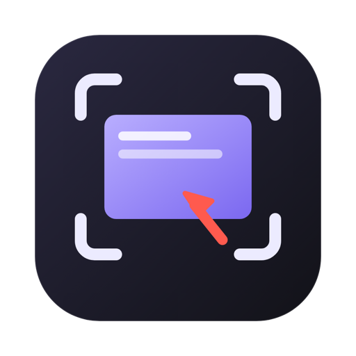
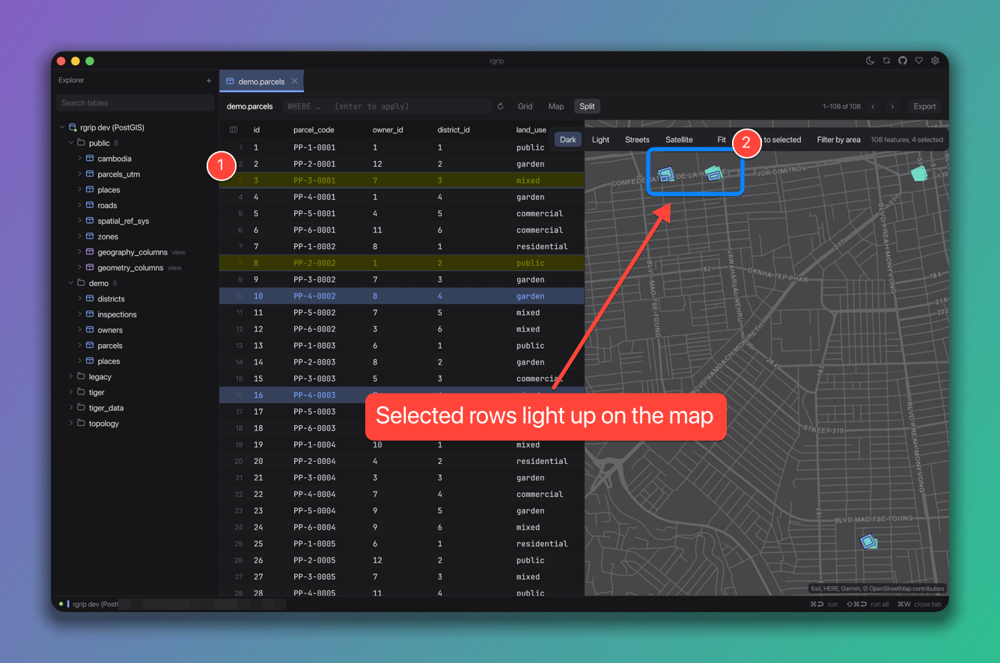
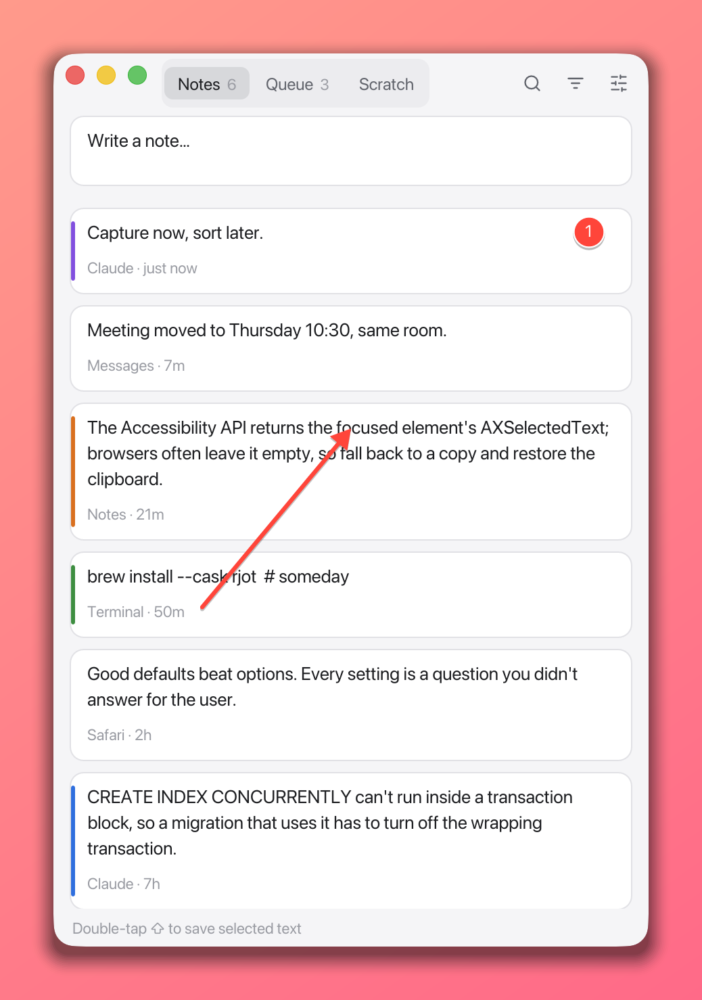
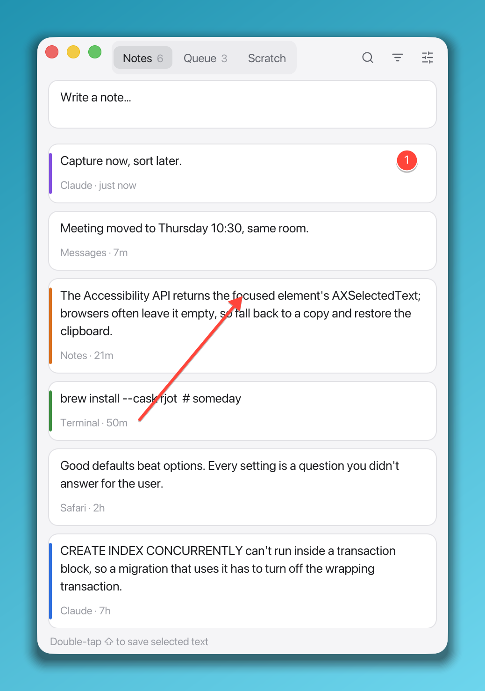
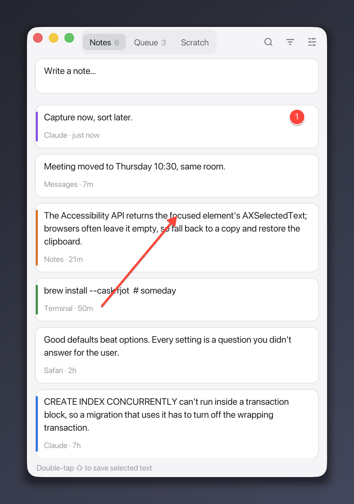
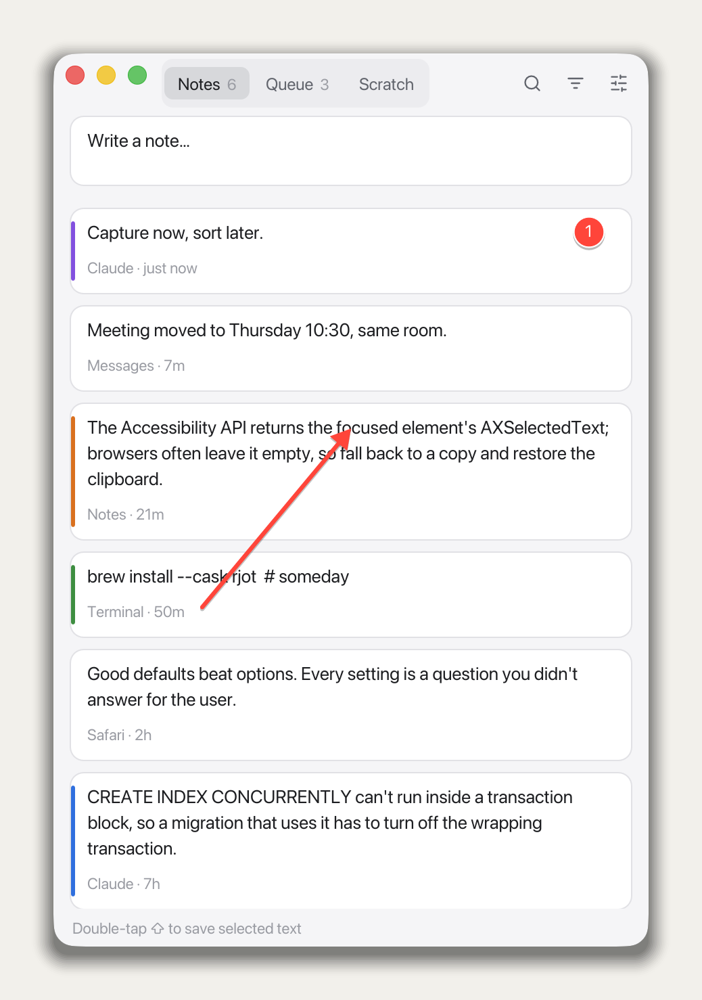
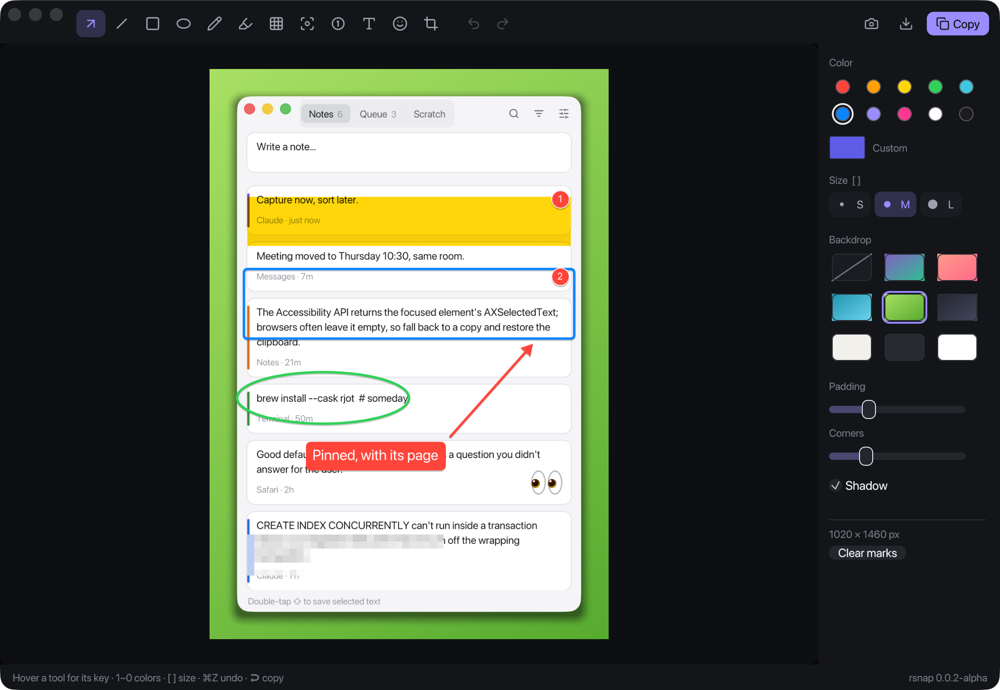

<p align="center"></p>

<h1 align="center">rsnap</h1>

<p align="center">Capture, frame it, mark it up, paste it. A small Mac screenshot tool.</p>

<p align="center">
  <a href="https://github.com/yoouTaro/rsnap/releases"></a>
  
  
</p>

<p align="center">
  <a href="https://yoouTaro.github.io/rsnap/">Website</a> ·
  <a href="https://github.com/yoouTaro/rsnap/releases">Download</a>
</p>

<p align="center"></p>

Press **⌥⇧S** anywhere and drag over what you want (or press Space and click a window). rsnap opens the shot in a small editor: put it on a backdrop with rounded corners and a soft shadow, point at things, hide what shouldn't be seen, and press **↩**. The finished image is on your clipboard, ready to paste into a chat, an issue or a doc.

The image above was made by rsnap's own renderer.

## What's in the editor

| Tool | Key | What it does |
|---|---|---|
| Arrow | A | Drag from where to where |
| Line | L | A plain straight line |
| Box | R | Drag a rounded outline |
| Ellipse | O | Circle the thing |
| Pen | P | Freehand, smoothed |
| Highlight | H | A highlighter: text under it stays dark |
| Redact | B | Pixelates what's underneath, for emails, tokens and names |
| Spotlight | F | Dims everything except the box you drag |
| Step | N | Numbered markers, counting up: 1, 2, 3 |
| Text | T | Click, type, ↩. Khmer is shaped properly, with subscripts stacked and vowels in place |
| Sticker | E | Click to place an emoji: 30 in the panel, or any emoji you type (⌃⌘Space) |
| Crop | C | Drag the part to keep; ⌘Z undoes it |

Ten colors on **1–0**, plus a custom one from the color picker. Three sizes, **S M L**, on **[** and **]**. The panel on the right has **backdrops** (none, five gradients, three plain colors), **padding**, **corners** and **shadow**. rsnap remembers your style for the next shot.

| Shortcut | Action |
|---|---|
| ⌥⇧S | Capture (anywhere) |
| ↩ or ⌘C | Copy to the clipboard and get out of the way |
| ⌘S | Save as PNG |
| ⌘Z / ⇧⌘Z | Undo / redo |
| 1–0 | Pick a color |
| [ / ] | Smaller / bigger marks |
| ⌘N | New capture |
| Esc | Close the editor |

<table>
  <tr>
    <td></td>
    <td></td>
    <td></td>
    <td></td>
  </tr>
</table>

<p align="center"></p>

## Privacy

rsnap needs one permission, **Screen Recording**, so macOS lets it see what you capture. It doesn't need Accessibility: the shortcut is a regular system hotkey. Shots stay on your Mac: on the clipboard, or in a file when you save one. There's no account, no upload and no analytics. The only network request is **Check for updates** (click the version in the bottom corner), and only when you click it.

## Install

Download the zip from [Releases](https://github.com/yoouTaro/rsnap/releases), unzip it, and move **rsnap.app** to your Applications folder. It's for Apple silicon. On other Macs, build from source.

It isn't notarized, so macOS blocks the first launch. Right-click **rsnap.app** and choose **Open**, or run:

```sh
xattr -dr com.apple.quarantine /Applications/rsnap.app
```

Then press ⌥⇧S, or click **Capture**, and allow Screen Recording when macOS asks. After that, rsnap updates itself from inside the app.

## Build

```sh
cargo run -p rsnap                # debug
sh scripts/bundle-macos.sh        # dist/rsnap.app and a zip, signed
sh scripts/make-signing-cert.sh   # once: a stable local signing certificate
sh scripts/screenshots.sh         # README screenshots from scripted scenes
```

The compositor (backdrop, shadow, annotations, shaped text) lives in `crates/core` and is tested on its own: `cargo test`. The editor's preview and the copied PNG come from the same function.

rsnap is the third app in a small family with [rgrip](https://github.com/yoouTaro/rgrip) (a Postgres client with a map) and [rjot](https://github.com/yoouTaro/rjot) (keep the text you highlight). Built the same way: Rust, egui, one small binary.

## License

[MIT](LICENSE)
